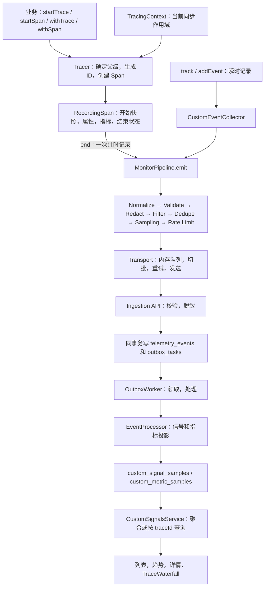
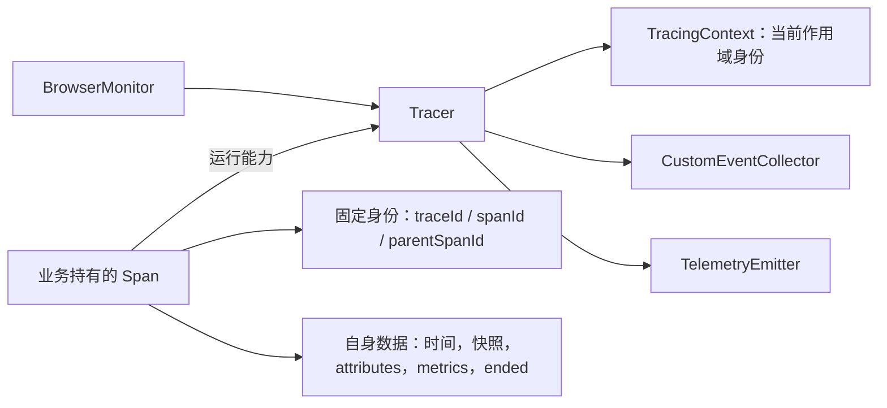
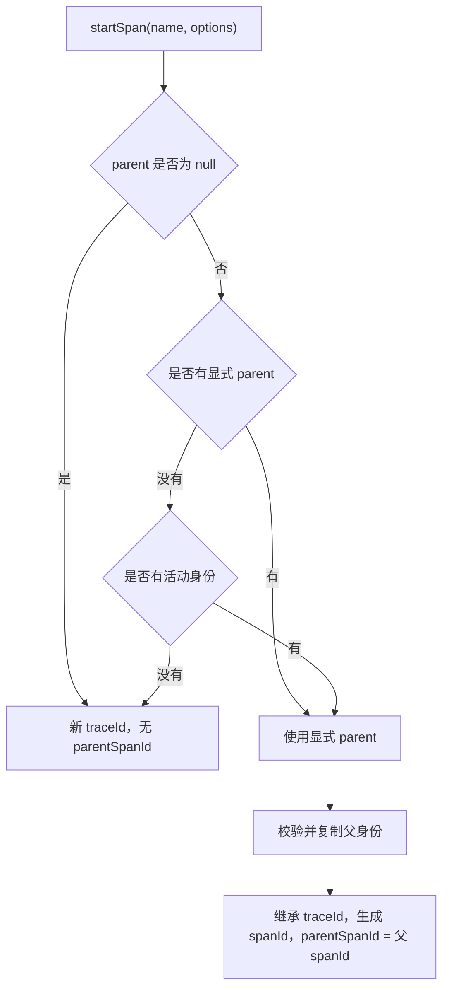
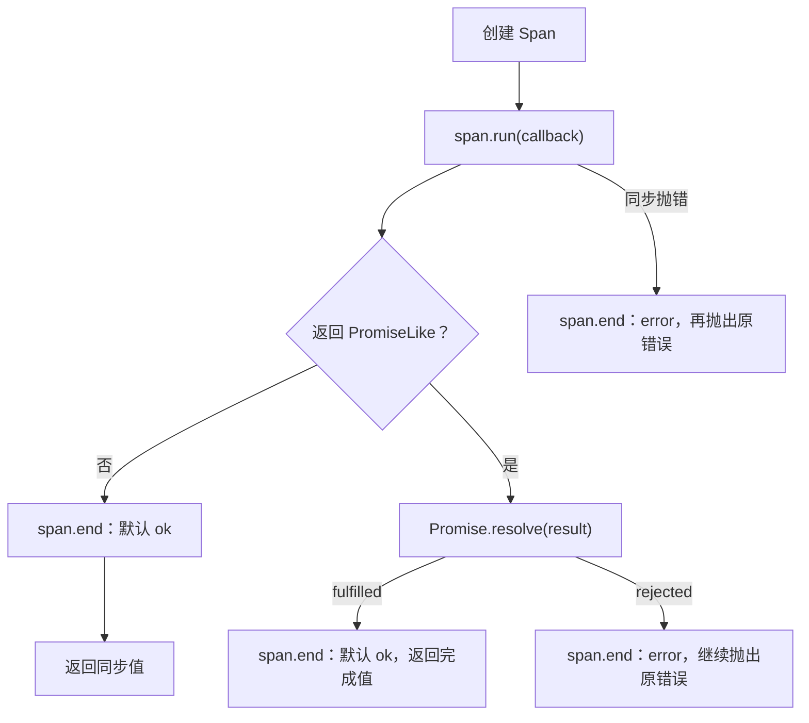
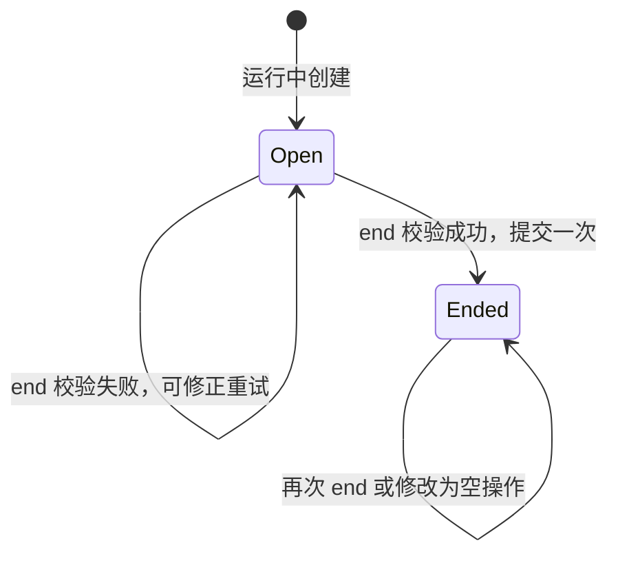
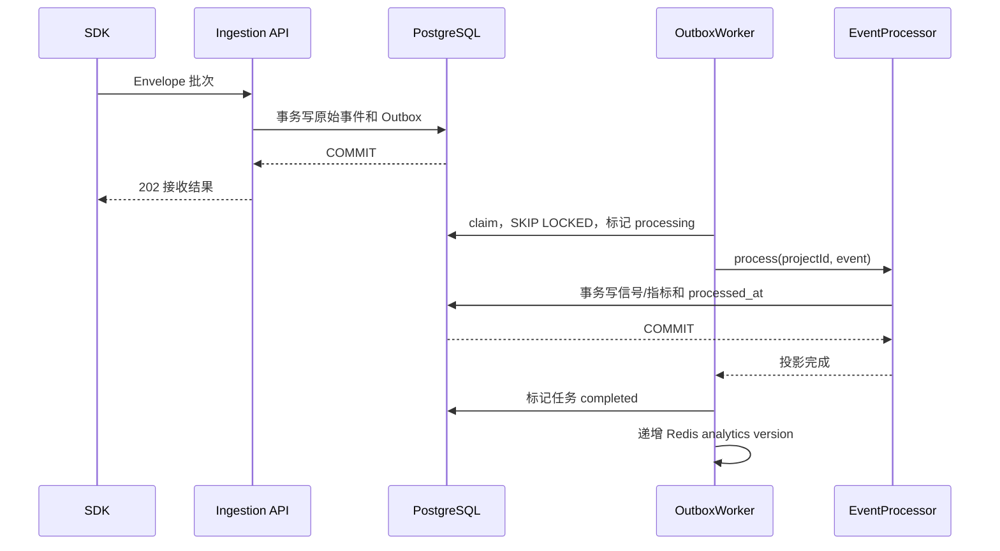

# Trace、Span 与 Event 完整链路：对象、上下文、上报和展示

通用模型可参考[监控 SDK 插桩与 Trace/Span 工程体系](https://github.com/cxDlogver/cx-learn-notes/blob/main/Full-Stack-AI-NOTES/J-监控SDK插桩与TraceSpan工程体系.md)；实际 SDK 的父子对象、Processing、Transport 和失败批次行为见[监控 SDK 业务插桩与 Trace/Span 执行链路源码分析](../../docs/监控SDK业务插桩与TraceSpan执行链路源码分析.md)。

本文从业务调用出发，沿着实际代码追踪一条链路如何建立、结束、发送、落库和展示。示例中的业务函数由应用提供，SDK 入口为 `cx-browser-monitor-sdk`。

## 1. 先看一条完整链路

`traceId` 标识一组相关操作；`spanId` 标识其中一次计时操作；`parentSpanId` 记录操作的直接父节点。Trace 是链路的概念，业务 API 返回的 `TraceHandle` 是一个带业务根标记的根 Span。

```text
checkout.flow                    traceId = T，spanId = R
├── checkout.address             traceId = T，spanId = A，parentSpanId = R
└── checkout.payment             traceId = T，spanId = P，parentSpanId = R
    ├── payment.request          traceId = T，spanId = Q，parentSpanId = P
    └── payment.method.selected  Event，关联 traceId = T，spanId = P
```

四个计时对象各自保存开始时间和数据，各自在 `end()` 时产生一条记录。Event 是时间点，调用时就产生记录。父子关系由 ID 表达。



创建对象、提交记录和发送 HTTP 是不同动作。`startSpan()` 创建对象；`end()` 提交记录到管线；`flush()` 尝试发送已经入队的记录。

## 2. 对象、职责和代码入口

### 2.1 三种信号

| 概念       | SDK 对象或入口                                           | 记录时机                            | 平台分类    |
| ---------- | -------------------------------------------------------- | ----------------------------------- | ----------- |
| 业务 Trace | startTrace 返回根 Span；TraceHandle = SpanHandle         | 根对象调用 end                      | trace       |
| 普通 Span  | startSpan 返回独立或有父级的 Span                        | 对象调用 end                        | span        |
| Event      | track 或句柄的 addEvent                                  | 调用时                              | event       |
| 链路上下文 | SpanContext：traceId、spanId                             | 创建子节点时读取                    | correlation |
| 页面上下文 | TelemetryContext：session、view、route、user、runtime 等 | Span 开始时取快照；Event 发生时解析 | context     |

根 Span 有自己的 spanId，因此直接子节点能明确指向根。

普通 Span 可以单独创建。没有父级时，它生成自己的 traceId，成为一条链路的根节点，但仍属于平台的 Span 分类。只有 startTrace / withTrace 创建的业务根进入 Trace 分类。

### 2.2 代码地图

下表链接相对本文所在目录，可以沿着顺序阅读。

| 文件                                                                                         | 核心入口                                    | 职责                                     |
| -------------------------------------------------------------------------------------------- | ------------------------------------------- | ---------------------------------------- |
| [core/monitor.ts](../src/core/monitor.ts)                                                    | BrowserMonitor                              | 创建依赖、公开 API、驱动生命周期         |
| [tracing/types.ts](../src/tracing/types.ts)                                                  | SpanContext / StartSpanOptions / SpanHandle | 对外类型契约                             |
| [tracing/tracer.ts](../src/tracing/tracer.ts)                                                | Tracer.create / wrap / track / emit         | 选择父级、创建对象、包装回调、运行状态门 |
| [tracing/context.ts](../src/tracing/context.ts)                                              | run / bind / current                        | 同步父级作用域及恢复                     |
| [tracing/span.ts](../src/tracing/span.ts)                                                    | RecordingSpan.end                           | 单个操作的计时、数据和定稿               |
| [tracing/id.ts](../src/tracing/id.ts)                                                        | createTraceId / createSpanId                | 生成非零十六进制 ID                      |
| [shared/custom-signal/index.ts](../src/shared/custom-signal/index.ts)                        | normalizeData / mergeData / presentData     | Event 和 Span 共用的数据归一化           |
| [collectors/event/custom/index.ts](../src/collectors/event/custom/index.ts)                  | CustomEventCollector.track                  | 瞬时事件草稿                             |
| [core/pipeline.ts](../src/core/pipeline.ts)                                                  | MonitorPipeline.emit                        | 补齐 Envelope，进入加工和发送链路        |
| [processing/index.ts](../src/processing/index.ts)                                            | createProcessingPipeline                    | 装配七个处理阶段                         |
| [transport/flush/index.ts](../src/transport/flush/index.ts)                                  | enqueue / flush / drain                     | 队列和发送调度                           |
| [protocol/src/schemas.ts](../../protocol/src/schemas.ts)                                     | telemetryEventV3Schema                      | 服务端完整协议校验                       |
| [ingestion.service.ts](../../platform/apps/api/src/ingestion/ingestion.service.ts)           | IngestionService.ingest                     | 接收、校验、持久化和 Outbox              |
| [outbox-worker.ts](../../platform/apps/worker/src/outbox-worker.ts)                          | run / claim / handle                        | 后台任务领取和重试                       |
| [processor.ts](../../platform/apps/worker/src/processor.ts)                                  | processCustomSignal                         | 信号和指标投影                           |
| [custom-signals.service.ts](../../platform/apps/api/src/analytics/custom-signals.service.ts) | CustomSignalsService.trace                  | 链路查询和完整性提示                     |
| [CustomSignalDetailPage.tsx](../../platform/apps/web/src/pages/CustomSignalDetailPage.tsx)   | TraceWaterfall                              | 按父 ID 和时间绘制链路                   |

### 2.3 内存中的关系



Tracer 不保存所有开放 Span，不计数，也不等待整条链路结束。子 Span 保存父节点 ID，不保存父对象或子节点集合。业务持有手动句柄并决定何时结束。

### 2.4 Monitor 初始化和依赖连接

`createMonitor()` 先校验配置，再创建 ContextManager、Transport、ProcessingPipeline、MonitorPipeline 和 Tracer。Tracer 与各 Collector 共享同一个 TelemetryEmitter，所有记录经过同一处理和发送出口。

`start()` 第一次执行 install，再执行各模块 start。注册顺序使采集消费者和 Transport 在浏览器 Instrumentation 发布信号前就绪；stop、destroy 按相反顺序执行。Tracer 没有额外的浏览器监听或计时器，每个 Monitor 的 TracingContext 相互独立。

```ts
import { createMonitor } from 'cx-browser-monitor-sdk';

const monitor = createMonitor({
  app: { name: 'shop', version: '1.0', environment: 'production' },
  transport: {
    dsn: 'https://monitor.example.com/api/v3/ingest/bm_pk_example/envelopes',
  },
});
monitor.start();
```

应用应使用项目设置提供的真实 DSN，app.name 与平台项目配置保持一致。此后调用下面的业务 API。

## 3. 公开 API

### 3.1 Monitor 入口

| API                                        | 语义                                                 |
| ------------------------------------------ | ---------------------------------------------------- |
| monitor.startTrace(name, data?)            | 创建新的业务根 Span，手动结束                        |
| monitor.withTrace(name, callback, data?)   | 创建业务根，激活回调同步作用域，回调完成时自动定稿   |
| monitor.trace(name, callback, data?)       | 与 withTrace 相同                                    |
| monitor.startSpan(name, options?)          | 显式父级优先，否则采用活动父级，没有父级则成为普通根 |
| monitor.withSpan(name, callback, options?) | 创建普通 Span，激活同步作用域并自动定稿              |
| monitor.track(name, data?)                 | 提交 Event，有活动身份时自动关联                     |
| monitor.flush()                            | 尝试发送队列中的记录                                 |

```ts
interface SpanContext {
  readonly traceId: string;
  readonly spanId: string;
}

interface StartSpanOptions {
  parent?: SpanContext | null;
  attributes?: Readonly<Record<string, unknown>>;
  metrics?: Readonly<Record<string, { value: number; unit: string }>>;
}
```

句柄自身符合 SpanContext，所以 parent 可以传 TraceHandle、SpanHandle，或只有两个 ID 的普通上下文对象。`parent: null` 明确要求新建链路。

### 3.2 句柄入口

Trace 和 Span 使用同一个契约。

| API / 字段                          | 语义                                           |
| ----------------------------------- | ---------------------------------------------- |
| traceId / spanId / parentSpanId     | 只读身份；根的 parentSpanId 为 undefined       |
| handle.startSpan(name, data?)       | 明确以此句柄为父创建子节点，手动结束           |
| handle.span(name, callback, data?)  | 明确以此句柄为父创建子节点，回调完成后自动结束 |
| handle.run(callback)                | 临时激活此身份执行同步回调，不自动结束句柄     |
| handle.bind(callback)               | 返回捕获此身份的新函数，稍后调用时临时激活身份 |
| handle.addEvent(name, data?)        | 句柄开放时提交关联 Event                       |
| handle.setAttribute(key, value)     | 更新自身属性                                   |
| handle.setMetric(name, value, unit) | 更新自身数值指标                               |
| handle.end(options?)                | 合并最终数据并定稿自身，只执行一次             |

## 4. 手动创建：从调用到对象

```ts
const trace = monitor.startTrace('checkout.flow', {
  attributes: { source: 'cart' },
  metrics: { amount: { value: 199.9, unit: 'CNY' } },
});

const payment = monitor.startSpan('checkout.payment', { parent: trace });
payment.setMetric('attempts', 1, 'count');
payment.addEvent('payment.method.selected', { attributes: { method: 'card' } });

payment.end();
trace.end();
await monitor.flush();
```

startTrace 的调用顺序：

1. BrowserMonitor.startTrace 转给 Tracer.startTrace。
2. Tracer 设置 parent 为 null，并标识此对象为业务根。
3. Tracer.create 确定没有父级，生成新的 traceId 和 spanId。
4. 运行状态下获取 ContextManager.snapshotAt，保存当前页面、用户和会话快照。
5. 创建 RecordingSpan，记录开始时间、复制固定身份、归一化初始数据。
6. 返回句柄。此时还没有 Span 记录入队。

startSpan 使用同一个工厂，区别在于父级选择和业务根标记。handle.startSpan 也调用工厂，把自身固定身份作为显式父级。

traceId 为 32 位小写十六进制字符串，spanId 为 16 位。优先使用 crypto.getRandomValues，缺少该能力时随机数降级，并确保不为全零。显式传入父上下文时也会校验这两个 ID 的格式和非零约束。

## 5. 父级选择的优先级



```ts
const other = monitor.startSpan('other.flow');

monitor.withTrace('checkout.flow', (trace) => {
  const implicit = monitor.startSpan('implicit');
  // implicit.parentSpanId === trace.spanId

  const explicit = monitor.startSpan('explicit', { parent: other });
  // 显式父级优先：属于 other.traceId

  const isolated = monitor.startSpan('isolated', { parent: null });
  // independent traceId，无父节点

  implicit.end();
  explicit.end();
  isolated.end();
});

other.end();
```

父级在创建时确定，后续活动作用域变化不影响现有 Span。父身份被复制，调用方后来修改传入的普通上下文对象也不会改变已有子节点。

startTrace 始终建立新业务链路，即使在另一个活动 Trace 内调用也会生成新的 traceId。需要同链路的子操作时使用 startSpan / withSpan。

## 6. 创建、激活、结束是三个动作

```ts
const trace = monitor.startTrace('manual.flow');
const outside = monitor.startSpan('outside');
// 创建 trace 不会激活它，因此 outside 不是它的隐式子节点

trace.run(() => {
  monitor.withSpan('inside', () => doSynchronousWork());
  monitor.track('inside.point');
});

outside.end();
trace.end();
```

TracingContext.run 的逻辑：

```text
保存 previous
→ active = 当前身份的冻结副本
→ 调用 callback
→ finally 恢复 previous
```

finally 在正常返回、抛错、返回 Promise 时都会执行。嵌套作用域恢复外层父级。

run 和 bind 只控制关联，不结束操作。withTrace / withSpan 在作用域之外，再提供自动结束行为。

## 7. 回调包装：同步、Promise 和异常

```ts
const total = monitor.withTrace('calculate.total', (trace) => {
  return trace.span('calculate.items', () => 42);
});
// total === 42

const order = await monitor.withTrace('checkout.submit', (trace) => {
  return trace.span('payment.request', async (span) => {
    span.setMetric('attempts', 1, 'count');
    return await submitPayment();
  });
});
```

Tracer.wrap 的分支：



包装器保留同步返回值、Promise 的完成值和错误传播语义。Promise 分支返回包装后的 Promise，不承诺原 Promise 的对象引用保持不变。

它只等待回调返回的 Promise。后台任务若没有被返回或 await，不会延长包装器的时间。

```ts
await monitor.withTrace('checkout.all', async (trace) => {
  await Promise.all([
    trace.span('inventory.check', () => checkInventory()),
    trace.span('payment.request', () => submitPayment()),
  ]);
});
```

这里根节点晚于两个子节点结束，是因为业务等待 Promise.all。SDK 没有额外的子节点计数。

回调若已手动 end，自动结束成为空操作；已提交状态不会被覆盖。业务吞掉异常并正常返回时，包装器按正常返回处理。

## 8. 浏览器异步上下文：跨 await 如何关联

本 SDK 的活动父级是同步作用域，没有安装 Zone，也没有修改 Promise 或 Timer。它不会让一个全局父级跨 Promise 生命周期存活。

```text
回调进入：active = A
    before 操作关联 A
    await：回调返回 Promise
run finally：恢复此前 active
    其他流程可以建立自己的作用域
await 后继续：
    通过 parent: A 或 A.startSpan / A.span 关联
Promise 完成：
    包装器结束 A
```

### 8.1 async/await：显式传递

```ts
await monitor.withTrace('checkout.flow', async (trace) => {
  monitor.withSpan('before.await', () => prepare());
  await loadCart();

  await monitor.withSpan('after.await', () => submitPayment(), { parent: trace });
  // 也可以使用 trace.span('after.await', () => submitPayment())
});
```

await 后若没有活动父级，也没传 parent，startSpan 会创建独立链路。

### 8.2 绑定后续回调

```ts
const trace = monitor.startTrace('button.workflow');
const onClick = trace.bind((event: MouseEvent) => {
  monitor.withSpan('button.handler', () => handleClick(event));
});

button.addEventListener('click', onClick);

// 所属业务生命周期结束：
button.removeEventListener('click', onClick);
trace.end();
```

bind 捕获身份，保留参数及调用时的 this。注册监听本身不激活作用域；只有新函数被调用时才激活。绑定 async 回调也只激活其同步部分，内部 await 之后仍需显式关联。

### 8.3 两条链路并行

```ts
await Promise.all([
  monitor.withTrace('task.a', async (trace) => {
    await workA();
    trace.span('a.after', () => finishA());
  }),
  monitor.withTrace('task.b', async (trace) => {
    await workB();
    trace.span('b.after', () => finishB());
  }),
]);
```

每条链路使用自己的句柄，不依赖跨 Promise 存活的全局父级。

## 9. Span 保存的状态

| 状态             | 用途                                                   |
| ---------------- | ------------------------------------------------------ |
| identity         | 固定 traceId、spanId、parentSpanId；结束后仍能用于关联 |
| name             | 信号分类和聚合名称                                     |
| startedAt        | 绝对开始时间，用于落库和时间轴                         |
| startedMonotonic | 单调时钟基准，用于耗时                                 |
| context          | 开始时的页面、用户等快照                               |
| data             | 结束前积累的属性和指标                                 |
| ended            | 阻止重复提交和结束后修改                               |
| workflow         | 决定业务根标记和分类                                   |
| runtime          | 提供工厂、作用域和提交能力                             |

Date.now 给出绝对时间，performance.now 用于耗时计算，缺少单调时钟时才降级。结束时：

```text
endedAt = max(startedAt, Date.now())
durationMs = max(0, monotonicNow() - startedMonotonic)
```

系统时钟调整时，durationMs 不一定等于 endedAt - startedAt。两者分别承担耗时计算和时间轴定位职责。

## 10. end 的完整逻辑

RecordingSpan.end 顺序如下：

1. ended 为 true 时直接返回。
2. status 默认为 ok，校验它属于 ok、error、cancelled。
3. 校验并合并最终属性、指标。指标先检查完整合并结果，再修改数据。
4. 读取结束时间和单调耗时。
5. 构建 CustomSpanPayload；业务根补入 monitor.workflow = true。
6. 标记 ended = true。
7. 调用 Tracer.emit；仅运行中提交到 TelemetryEmitter。



先标记结束再 emit，可以阻止重入产生第二条记录。输入校验失败发生在 ended 变化之前，因此可以修正后重新结束。

end 不等待网络，同步工作到处理和入队为止。已经结束不等于已发送或已接收。

结束后的 setter 和 addEvent 不改变已提交记录。身份仍可读取，startSpan、span、run、bind 仍可用于关联后续操作。

## 11. 父结束与子结束各自独立

父子关系表达来源和因果联系。各自的时间范围由被观测操作决定。

```text
时间：       0 ms            80 ms        120 ms
request     [----------------] end
background       [-------------------------] end
                 parentSpanId = request.spanId
```

```ts
const trace = monitor.startTrace('request');
const background = trace.startSpan('background');
trace.end(); // 只结束 request
background.end(); // 保留自身正常记录
```

父结束不会给子节点填 cancelled，不会取消业务任务，也不会使父身份失效。新子节点可以引用已经结束的父上下文。

如果业务定义“所有阶段完成才结束流程”，就应明确等待任务，再结束根：

```ts
const trace = monitor.startTrace('payment.flow');
const payment = trace.startSpan('payment.request');

try {
  await submitPayment();
  payment.end();
  trace.end();
} catch (error) {
  payment.end({ status: 'error' });
  trace.end({ status: 'error' });
  throw error;
}
```

业务使用 AbortController 时，应在真实取消处理路径结束相应 Span。根 duration 表示自身观测区间，不是所有子 duration 之和；并行子操作相加会重复计算时间。

## 12. Event 的关联链路

```ts
monitor.track('button.click', {
  attributes: { channel: 'web' },
  metrics: { itemCount: { value: 3, unit: 'count' } },
});

trace.run(() => monitor.track('workflow.point'));
payment.addEvent('payment.method.selected', { attributes: { method: 'card' } });
```

Tracer.track 优先采用调用方提供的关联；未提供时读取活动身份；无活动身份时 correlation 为空。

handle.addEvent 传入自身完整关联，不依赖当前作用域。已结束句柄的 addEvent 为空操作。

CustomEventCollector.track 校验名称和数据，以当前时间构建 Event 草稿。Event 没有 startedAt、endedAt、durationMs 和 status。

Event 的 spanId 指向所属计时节点，它没有另外的自身 spanId；eventId 标识记录自身。parentSpanId 若存在，描述关联 Span 的父节点。展示 Event 时使用 spanId 找到所属节点。

## 13. 属性和指标约束

Event 和 Span 共用 shared/custom-signal：

- 名称去除首尾空白，不能为空，最长 128 字符。
- 自定义数据仅接受 attributes、metrics；Span 创建另有 parent，结束另有 status。
- 普通信号最多保留 50 项顶层属性；业务根保留 49 项业务属性，为系统标记预留一项。
- 属性键最长 128 字符，字符串截断到 4096 字符，包括嵌套字符串。
- 嵌套对象和数组每层最多 50 项，达到深度限制时截断。
- 非有限属性数字转换为 null；不适合 JSON 的值按归一化规则处理。
- 每条记录最多 20 个业务指标，初始和合并数据都受约束。
- 指标值必须是有限数字；负数可用于有正负意义的业务指标。
- 指标名最长 64 字符，duration 是保留指标，不能业务覆盖。
- 单位最长 32 字符、字母开头，允许规定字符。可使用 ms、s、bytes、count、percent、score 或业务单位。
- monitor.workflow 是保留系统属性，创建、setter、end 都禁止业务覆盖。

mergeData 对指标先合并后校验总数，失败不提交合并结果。属性采用有界合并，超限的新增键可能被截断。之后还会经过脱敏；业务根的布尔系统标记在脱敏中保留。

平台按“信号分类 + 名称”区分信号，指标再按名称和单位分组。同名指标不同单位分别统计。

## 14. 两种 Context 的区别

```text
TracingContext
  解决：下一次 Span 的父节点是谁？
  保存：traceId、spanId
  有效期：同步 run 进入到 finally 恢复

ContextManager
  解决：记录属于哪个会话、页面和用户？
  保存：sessionId、viewId、routeName、url、user、runtime 等
  有效期：Monitor 和页面上下文
```

Span 在开始时保存页面快照。地址页开始、付款页结束的 Span 仍归属地址页；每个子节点独立取开始快照，因此同一 traceId 可以跨路由。

Event 在发生时由 Pipeline 解析页面上下文。payment.addEvent 使用 payment 的链路身份，同时记录 Event 发生时所在的页面。

链路身份不覆盖页面上下文，页面快照也不会充当活动父级。

## 15. 草稿如何成为 Envelope

Span.end 的草稿包含 name、timestamp、payload、correlation 和开始时的 context。Pipeline 补齐 protocolVersion、eventId、app，并按 payload 设置顶层 type。

业务根示例：

```json
{
  "protocolVersion": "3.0",
  "eventId": "event_example",
  "type": "span",
  "name": "checkout.flow",
  "occurredAt": 1767225600200,
  "app": { "name": "shop", "version": "1.0", "environment": "production" },
  "context": {
    "sessionId": "session_example",
    "viewId": "view_example",
    "routeName": "/checkout",
    "url": "https://shop.example.com/checkout",
    "runtime": { "sdk": { "name": "cx-browser-monitor-sdk", "version": "0.3.0" } }
  },
  "correlation": {
    "traceId": "4bf92f3577b34da6a3ce929d0e0e4736",
    "spanId": "00f067aa0ba902b7"
  },
  "payload": {
    "type": "span",
    "name": "checkout.flow",
    "source": "custom",
    "startedAt": 1767225600000,
    "endedAt": 1767225600200,
    "durationMs": 200,
    "status": "ok",
    "attributes": { "monitor.workflow": true }
  }
}
```

子节点 correlation 另有 parentSpanId。根和子都用 span 记录，每个操作只有一条计时记录。

共享协议要求 Span 具有 traceId 和 spanId，parentSpanId 可选；也支持 type = trace 的无 spanId 摘要，平台能够读取这种结构。它不要求父节点已到达，也不要求子时间被父时间包围。

本项目没有自动 HTTP traceparent 传播、Span Links 或完整 OpenTelemetry 导出格式。业务上下文可以显式传入，传播边界由应用控制。

## 16. 七个处理阶段

| 顺序 | 阶段       | 影响                                                   |
| ---- | ---------- | ------------------------------------------------------ |
| 1    | Normalize  | 修正名称、发生时间和 URL                               |
| 2    | Validate   | 检查公共元数据及性能字段；自定义字段先由创建入口归一化 |
| 3    | Redact     | 脱敏自定义属性和 URL                                   |
| 4    | Filter     | 排除配置的页面                                         |
| 5    | Dedupe     | 自定义 Event、Trace、Span 保留重复业务样本             |
| 6    | Sampling   | 同会话、同 traceId 使用一致的稳定采样结果              |
| 7    | Rate Limit | 按单条记录限速，可能截断链路                           |

SDK ValidateStage 没有逐条调用完整 Zod 协议 Schema。完整协议校验位于服务端接收流程，创建入口负责将自定义字段归一化到约束内。

当前采样以 sessionId、traceId 构造稳定键，发生在记录进入管线时。Tracer 不保存 sampled 状态，SpanContext 没有 traceFlags。

采样一致不代表最终链路必然完整。过滤、限流、队列淘汰、网络失败、接收拒绝和查询范围都可能减少记录。

## 17. Transport：队列、切批和发送

```text
enqueue → MemoryQueue
→ 定时 / 达到 batchSize / flush / hidden / pagehide / stop / destroy
→ Transport.flush：合并并发冲刷
→ drain：每轮 takeBatch
→ sendWithRetry → HttpSender.send
```

默认最多 200 条内存记录，每批 20 条，10 秒周期，最多 3 次发送尝试。具体取值以 core/config 的归一化配置为准。

队列满时淘汰低优先级较早记录；View 和 Event 优先级高于 Span、Trace、Performance。没有磁盘持久化。

maxBatchBytes 当前以 JSON.stringify(envelope).length 估算，未精确计算 UTF-8 字节或外层批次体积，首条超限记录可能仍被取出。

Sender 包装为 TelemetryBatchV3：protocolVersion、sentAt、SDK 身份和 events。普通路径使用 fetch；网络异常、408、429、5xx 可有限重试，其余失败直接终止；退避带指数增长和随机抖动。

hidden / pagehide 时首批优先 Beacon，排队失败降级 fetch，后续批次使用普通发送。

takeBatch 已从队列移走当前批次。重试耗尽后当前批次不会自动放回，尚未取出的后续数据留队。因此 flush 不是持久化或必达保证。

## 18. Monitor 生命周期与开放句柄

| 时机                    | 记录行为                                       | 手动对象                         |
| ----------------------- | ---------------------------------------------- | -------------------------------- |
| 未 start                | 创建不提交数据的句柄；包装回调照常执行         | 之后 start 不会使该对象补录      |
| running                 | 正常创建和提交                                 | 调用方决定 end                   |
| stop                    | 暂停发射；Transport 冲刷已入队记录             | 不自动结束或 cancelled           |
| stop 期间 end           | 对象进入 ended，但发射被丢弃                   | restart 后再次 end 不补发        |
| stop 后未 end，再 start | 恢复正常发射                                   | 可以结束，时长含暂停区间         |
| pagehide                | 生命周期采集器生成各自最终记录，Transport 冲刷 | 通用业务 Span 不自动结束         |
| destroy                 | 清理模块和订阅，永久关闭 Tracer                | 后续提交被忽略，业务任务不受取消 |

停用时获取的句柄也有身份，但该对象不补录；恢复后若用它创建新的记录，查询可能缺少那个父节点。已结束父身份也可继续用于关联。

若需要统计暂停前阶段，应先 end 再 stop。页面停留应由所属业务生命周期决定提交时间，并配合离页发送时机。

## 19. 接收 API：持久化原始记录

入口：

```text
POST /api/v3/ingest/:publicKey/envelopes
IngestionController.ingestBatch → IngestionService.ingest
```

接收顺序：

1. 解码请求并校验 V3 批次头，批次限 1–100 条，请求体上限 256 KiB。
2. 按 publicKey 查询项目，检查 Origin、项目及 IP 限流。
3. 逐条完整协议校验，检查 app.name 和发生时间。
4. 对有效记录脱敏，同批按 eventId 去重。
5. 事务内检查历史 ID，将新 telemetry_events 和 outbox_tasks 同时写入。
6. 提交事务，返回接受及拒绝结果，接收成功响应为 202。

允许的 occurredAt 为当前时间前 30 天至后 5 分钟。单条非法可以单独拒绝，其他有效记录仍可接受。

项目和 eventId 定义接收幂等。重复发送不会为同一记录产生多个有效任务；父子节点暂缺不阻止单条接收。

HttpSender 当前只检查 response.ok，不读取逐条拒绝结果。因此 HTTP 成功仍可能包含被服务端拒绝的记录。

## 20. Outbox 和 Worker：投影为查询数据



Worker 从 PostgreSQL 拉取任务，默认每次领取 100 条、分组并发处理。claim 使用 FOR UPDATE SKIP LOCKED，超时 processing 任务可再领取。

EventProcessor.process 为单条记录开启事务，自定义信号进入 processCustomSignal：

- 写 custom_signal_samples：分类、名称、状态、时间、关联 ID、上下文、属性。
- 逐个展开业务指标到 custom_metric_samples。
- 计时信号补 duration / ms。
- 更新原始事件 processed_at，并提交事务。

任务 completed 更新及 Redis 版本更新发生在投影提交之后，并非同一个原子事务。投影用 ON CONFLICT DO NOTHING 保持重放幂等。

失败按退避策略重试；达到次数上限进入 failed 和死信。父子投影没有顺序保证，也不等待整条链路结束。

## 21. 根 Span 的业务 Trace 分类

[WORKFLOW_ATTRIBUTE](../../protocol/src/constants.ts) 为 monitor.workflow。

```text
SDK 业务根：
  payload.type = span
  attributes["monitor.workflow"] = true
  有根 spanId，无 parentSpanId

Worker：
  type 为 span
  且 marker 严格等于布尔 true
  且无 parentSpanId
  → kind = trace
```

主信号 kind 和指标 signal_kind 使用同一分类；traceId、spanId、parentSpanId 原样保留。

| 输入                  | 投影分类 | 身份                 |
| --------------------- | -------- | -------------------- |
| 带业务标记的无父 Span | trace    | 保留 traceId、spanId |
| 普通无父 Span         | span     | 保留 traceId、spanId |
| 有父 Span             | span     | 保留全部关联         |
| 协议 trace 摘要       | trace    | traceId，无 spanId   |
| Event                 | event    | 保留已有关联         |

原始 telemetry_events 保留输入内容。一个业务根只有一条计时记录和一个 duration 样本，不会因分类产生两份根统计。

## 22. 聚合与 traceId 查询

分类统计按 kind、name、metric、unit、时间和业务筛选读取聚合结果。duration 是 Worker 展开的数值指标，可用 sum、avg、p95 等聚合。

链路详情入口：

```text
GET /api/v1/projects/:projectId/analytics/traces/:traceId
AnalyticsController.customTrace → CustomSignalsService.trace
```

先检查访问权限，再按项目、traceId 及当前筛选查询 custom_signal_samples，关联指标，最多返回 1000 条，按 occurredAt / eventId 排序。

完整性判断：

1. 取到超过 1000 条时提示截断。
2. 没有 Trace 分类记录，也没有无父普通 Span 时，提示缺少根。
3. 收集所有计时节点 spanId，包含 Trace 分类的根 Span。
4. parentSpanId 找不到时，提示缺少父。
5. Event 关联的 spanId 找不到时，提示缺少所属节点。

完整性反映当前结果的结构可解析程度。SDK 不提交预期子节点数量，因此查询无法证明全部业务操作已完成，也无法识别所有未上报子节点。

时间、路由、环境、版本筛选可以裁剪同一链路。父节点未结束或未投影、条数上限、原始样本保留期都会影响详情。数据库聚合视图按刷新策略更新，Span.end 和看板变化不是同步动作。

## 23. 瀑布图的层级与时间轴

TraceWaterfall 的计算：

1. 按 startedAt 或 Event 的 occurredAt 排序。
2. 最早开始为原点，最晚结束或 Event 时间为右边界。
3. 所有有 spanId 的计时记录建立 Map，含业务根 Trace。
4. 沿 parentSpanId 每条真实父边增加一级。
5. Event 按 spanId 找所属计时节点，再加一级。
6. 无 spanId 的 Trace 摘要显示在顶层，其下无父 Span 使用展示层级。
7. 父遍历使用已访问集合，防止异常循环。

```text
根                     depth 0
└── 子                 depth 1
    └── 孙             depth 2
        └── Event      depth 3
```

条形位置取开始时间，宽度取 durationMs，Event 显示时间点。ok 蓝色、error 红色、cancelled 橙色。点击查看属性、指标和身份。

子节点可以晚于父节点结束；时间轴覆盖全部可见记录，不会因根先结束而裁掉子节点。系统时钟变化时，单调 duration 与绝对时间轴可能存在差异。

## 24. 页面停留和跨路由流程

```tsx
import { useEffect } from 'react';
import type { Monitor, TraceHandle } from 'cx-browser-monitor-sdk';

function ProductPage({ monitor, trace }: { monitor: Monitor; trace?: TraceHandle }) {
  useEffect(() => {
    monitor.setViewName('product-detail');
    const stay = monitor.startSpan('product.page.stay', {
      parent: trace ?? null,
      attributes: { page: 'product-detail' },
    });
    return () => stay.end();
  }, [monitor, trace]);

  return <main>Product</main>;
}
```

effect 清理结束页面阶段，不结束业务根。真实页面卸载时，业务应配合生命周期安排结束和冲刷；SDK 不遍历所有手动对象代替清理。

```ts
const trace = monitor.startTrace('checkout.flow', { attributes: { source: 'cart' } });

// 地址页开始、完成
const address = trace.startSpan('checkout.address');
address.end();

// 付款页开始、完成
const payment = trace.startSpan('checkout.payment');
payment.addEvent('payment.method.selected', { attributes: { method: 'card' } });
payment.end({ metrics: { retries: { value: 1, unit: 'count' } } });

// 整体流程完成
trace.end();
```

Trace 统计整体流程，Span 统计各阶段，并各自保存开始路由。平台选择 span / product.page.stay / duration / ms / sum 看总停留时间，avg 或 p95 看单次分布。

## 25. 排查记录消失在哪一步

| 现象                    | 检查                                         |
| ----------------------- | -------------------------------------------- |
| 只有句柄，无记录        | 是否调用 end                                 |
| end 后未入队            | 是否 running；数据、过滤、采样、限流         |
| 较早 Span 缺失          | 队列容量和优先级淘汰                         |
| 失败后本批缺失          | 当前批重试结果，不会自动重新入队             |
| HTTP 成功，部分记录缺失 | 服务端逐条拒绝结果                           |
| 接收成功，尚不可查询    | Outbox 投影、重试、死信                      |
| 链路缺根或父            | 父是否结束，筛选裁剪，投影进度，条数和保留期 |
| await 后新 traceId      | 是否显式 parent 或使用句柄方法               |
| 业务根在 Span 分类      | 系统标记是否为 true，是否有 parentSpanId     |
| 指标未立即变化          | 投影、聚合刷新和缓存                         |

应区分：Span 已定稿、浏览器尝试发送、API 已持久化、Worker 已投影。Beacon 返回 true 只确认浏览器接受排队，不确认服务端接收。

## 26. 测试入口和语义依据

| 测试                                                                                               | 覆盖                                                                                                         |
| -------------------------------------------------------------------------------------------------- | ------------------------------------------------------------------------------------------------------------ |
| [SDK custom.spec.ts](../tests/event/custom.spec.ts)                                                | 独立根、父级优先、父先结束、开始快照、包装值与异常、并行 await、run/bind、启停、pagehide、数据边界、单调时间 |
| [Worker custom-signals.spec.ts](../../platform/apps/worker/tests/custom-signals.spec.ts)           | 信号及指标展开、根分类、ID 保留、标记类型和根条件                                                            |
| [API custom-signals.service.spec.ts](../../platform/apps/api/tests/custom-signals.service.spec.ts) | 根 Span、摘要、缺失关联节点、条数上限                                                                        |
| [Web CustomEventsPage.spec.tsx](../../platform/apps/web/src/pages/CustomEventsPage.spec.tsx)       | 根层级、Event 挂载、晚结束子节点、记录下钻                                                                   |

创建不自动激活上下文、父结束不结束子、结束身份仍能传播，参见 [OpenTelemetry Trace API](https://opentelemetry.io/docs/specs/otel/trace/api/)。

运行环境的 Context Manager 决定异步传播能力，参见 [OpenTelemetry JavaScript Context](https://opentelemetry.io/docs/languages/js/context/)。本文同步作用域、显式跨异步关联、协议、采样和业务分类均以项目实际代码为准。
